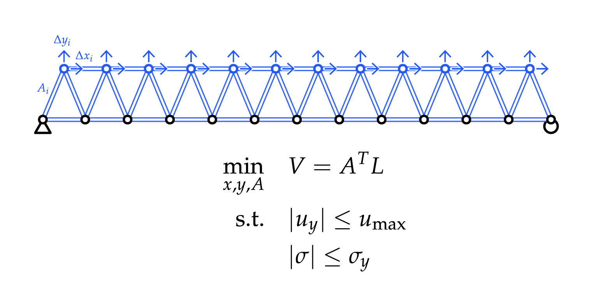
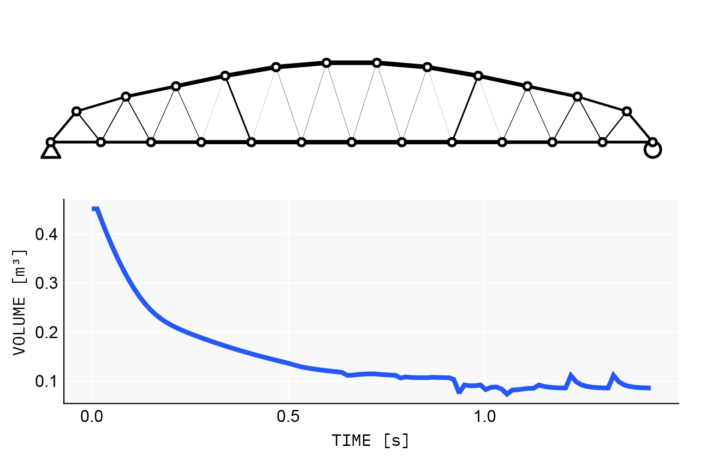

# Constrained optimization and AD



Add member areas as variables, and minimize material volume subject to displacement and stress limits. Without the constraints the trivial optimum is a flat truss of zero area; with them, depth trades against member force. This continues the [Quick start](quickstart.md) model:

```julia
vars = AbstractVariable[
    [SpatialVariable(node, 0.0, xmin, xmax, :X) for node in model.nodes[:top]];
    [SpatialVariable(node, 0.0, ymin, ymax, :Y) for node in model.nodes[:top]];
    [AreaVariable(element, element.section.A, 0.01 * element.section.A, 5 * element.section.A)
     for element in model.elements]
]

params = OptParams(model, vars)
x0 = copy(params.values)

# objective: material volume (geometry only, no solve needed)
function obj(x, p)
    geo = GeometricProperties(x, p)
    dot(geo.L, geo.A)
end
OBJ = x -> obj(x, params)

# constraints: g(x) .<= 0 is feasible (Nonconvex.jl convention), each row
# normalized by its limit, because mixed-scale constraint rows stall MMA.
# DOF layout: 6 DOFs per node, so vertical displacements are U[2:6:end]
function cstr(x, p, dmax, smax)
    res = solve_structure(x, p)
    return [
        abs.(res.U[2:6:end]) ./ dmax .- 1.0;
        abs.(axial_stress(res, p)) ./ smax .- 1.0
    ]
end
CSTR = x -> cstr(x, params, dmax, fy)

optmodel = Nonconvex.Model(OBJ)
addvar!(optmodel, params.lb, params.ub)
add_ineq_constraint!(optmodel, CSTR)

res = optimize(optmodel, NLoptAlg(:LD_MMA), x0,
    options = NLoptOptions(maxeval = 500, maxtime = 60))

model2 = updatemodel(params, res.minimizer)
```



## AD backends: reverse for objectives, forward for constraints

Loading **Zygote** (or anything ChainRulesCore-aware) is all the setup reverse-mode AD needs: Asap's rule extension activates automatically, and this package has no custom rules. **ForwardDiff**, **Mooncake** and **Enzyme** (both modes) also work.

The rule of thumb, from the benchmarks in [`docs/AD_BACKENDS.md`](https://github.com/keithjlee/AsapOptim.jl/blob/main/docs/AD_BACKENDS.md):

- **Scalar objectives** (compliance, volume): reverse mode, with Zygote or Enzyme. The cost is about one extra adjoint solve, independent of the number of design variables.
- **Constraint Jacobians** (per-element stresses, nodal displacements): **forward mode, with ForwardDiff**. A forward Jacobian costs the same as a forward gradient, because extra outputs are free. On constraint blocks it beats reverse mode by two orders of magnitude: the 512×512 stress Jacobian of the benchmark spaceframe takes **43 ms with ForwardDiff and 7.6 s with Zygote**.

This holds whenever there are at least as many constraint rows as design variables, which describes most sized or shaped structural problems, since stresses are checked in every element.

## Choosing the linear solver

[`OptParams`](@ref) takes a `solver` keyword that applies to every solve through the params: values, reverse-mode adjoints and forward-mode tangents alike.

```julia
params = OptParams(model, vars)                               # built-in CHOLMOD
params = OptParams(model, vars; solver = KLUFactorization())  # any LinearSolve.jl algorithm
params = OptParams(model, vars; solver = Asap.CachedSolver()) # factorization sharing (below)
```

## Sharing work between the objective and the constraints

At each optimizer iterate, the objective gradient, the constraint Jacobian and every ForwardDiff chunk assemble and factorize the *same* stiffness matrix. `Asap.CachedSolver()` makes them share one factorization. It keys on the stiffness values, reuses the factorization when they are unchanged, and refactorizes numerically (reusing the symbolic analysis) when they move. Your objective and constraint code does not change; it is purely a `params` setting. Use one `CachedSolver` per `OptParams`. Standard AD drivers and optimizer loops satisfy its documented atomicity contract automatically.

The complete pattern, with mixed AD, a shared factorization and NLopt driven directly, is `examples/truss-optimization3-nlopt.jl`. Distilled:

```julia
using NLopt, Zygote, ForwardDiff, DifferentiationInterface

params = OptParams(model, vars; solver = Asap.CachedSolver())
x0 = copy(params.values)

volume(x) = begin geo = GeometricProperties(x, params); dot(geo.L, geo.A) end
constraints(x) = begin                      # g(x) .<= 0, rows normalized by limits
    res = solve_structure(x, params)
    [abs.(res.U[2:6:end]) ./ dmax .- 1.0; abs.(axial_stress(res, params)) ./ fy .- 1.0]
end

# reverse mode for the scalar objective
function nlopt_objective(x, grad)
    v, g = Zygote.withgradient(volume, x)
    length(grad) > 0 && (grad .= g[1])
    return v
end

# prepared FORWARD mode for the constraint Jacobian
backend = AutoForwardDiff()
prep = prepare_jacobian(constraints, backend, x0)
function nlopt_constraints!(result, x, grad)   # NLopt wants grad = J' (n × m)
    v, J = value_and_jacobian(constraints, prep, backend, x)
    result .= v
    length(grad) > 0 && (grad .= J')
end

opt = Opt(:LD_MMA, length(x0))
NLopt.lower_bounds!(opt, params.lb); NLopt.upper_bounds!(opt, params.ub)
NLopt.min_objective!(opt, nlopt_objective)
NLopt.inequality_constraint!(opt, nlopt_constraints!, fill(1e-8, length(constraints(x0))))
minf, minx, ret = optimize(opt, x0)
```

On the example-2 problem this runs 500 MMA iterations in about 7 s, where the all-Zygote Nonconvex formulation needs about 60 s. To stay in Nonconvex.jl, wrap the same per-function derivatives with `Nonconvex.CustomGradFunction(f, g)` instead.

## Even faster constraint Jacobians: implicit differentiation

For the common constraint quantities, [`solution_tangents`](@ref)`(x, params)` computes the exact solution tangents `∂U/∂x` by the implicit-function theorem, with one factorization and one multi-RHS back-substitution. It is about **10× faster than the prepared ForwardDiff Jacobian** (3.9 ms against 43 ms on a 512-element, 512-variable benchmark) with about 20× less allocation:

```julia
t = solution_tangents(x, params)        # res + ∂U/∂x, exact
J = [
    -t.dU[3:6:end, :];                  # vertical-displacement rows
    axial_stress_jacobian(t, params)    # stress rows
]
```

It works for any mix of spatial, area, section, joint variables and couplings, including members with element loads, whose fixed-end forces enter the tangents. It is verified to machine precision against ForwardDiff and Zygote, and it respects `params.solver`. It is a plain-`Float64` evaluation path for optimizer callbacks, not itself differentiable.

Enzyme notes: reverse mode works (`examples/ad_backends/`). Forward mode is verified correct on Julia 1.11 with the default solver and is a useful independent check, but ForwardDiff is faster for Jacobians. See [`docs/AD_BACKENDS.md`](https://github.com/keithjlee/AsapOptim.jl/blob/main/docs/AD_BACKENDS.md) for the current per-version status.
