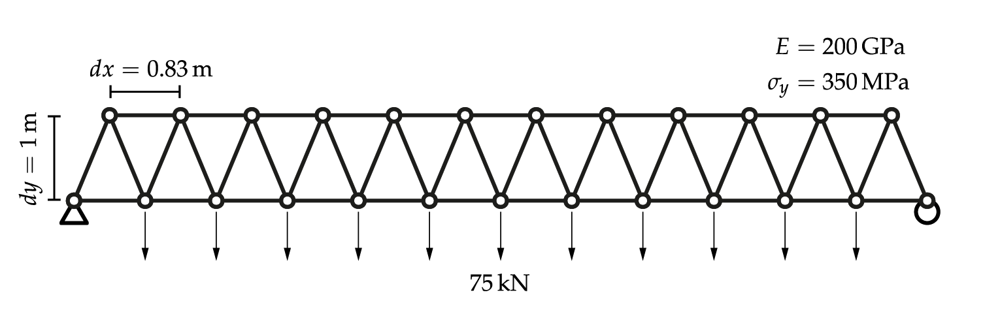
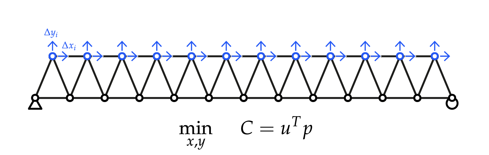
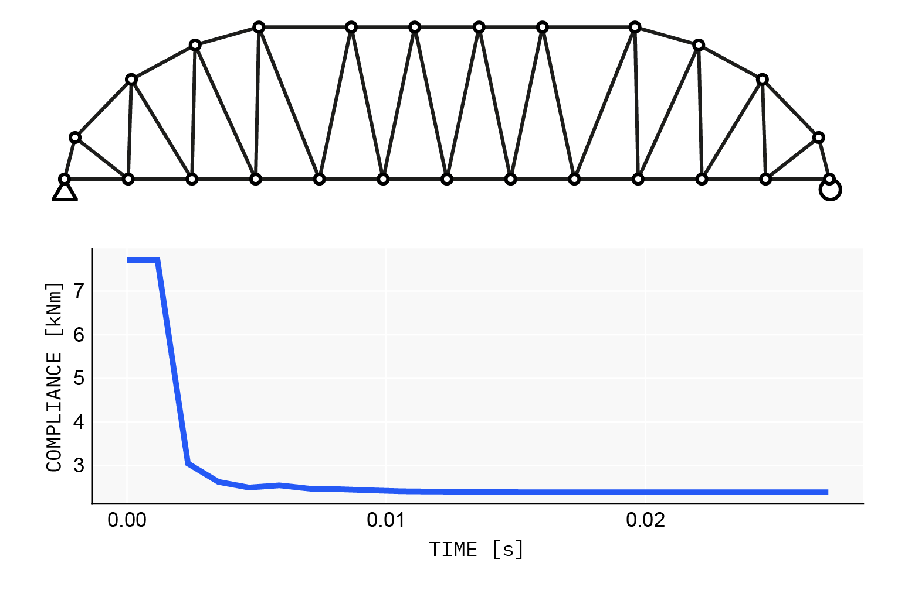

# Quick start: geometry optimization

The runnable files for this page are in the repository's `examples/` folder. Consider this truss:



Built with Asap:

```@example quickstart
using Asap

steel = Material(200e6, 80.0, 0.3)        # E [force/length²], ρ, ν
section = Section(steel, 0.01)            # axial-only, A = 0.01

L = 10.0    # span
nx = 12     # bays
dy = 1.0    # depth
load = 75.0 # per-node load
dx = L / nx

bottom_nodes = [Node([x, 0.0, 0.0], :free, :bottom) for x in range(0, L, nx + 1)]
fixnode!(first(bottom_nodes), :pinned)
fixnode!(last(bottom_nodes), :xfree)

top_nodes = [Node([dx / 2 + dx * (i - 1), dy, 0.0], :free, :top) for i in 1:nx]

bottom_elements = [TrussElement(bottom_nodes[i], bottom_nodes[i+1], section, :bottom) for i in 1:nx]
top_elements = [TrussElement(top_nodes[i], top_nodes[i+1], section, :top) for i in 1:nx-1]
web_elements = [
    [TrussElement(nb, nt, section, :web) for (nb, nt) in zip(bottom_nodes[1:end-1], top_nodes)];
    [TrussElement(nt, nb, section, :web) for (nt, nb) in zip(top_nodes, bottom_nodes[2:end])]
]

nodes = [bottom_nodes; top_nodes]
elements = AbstractElement{Float64}[bottom_elements; top_elements; web_elements]
loads = AbstractLoad{Float64}[NodeForce(node, [0.0, -load, 0.0]) for node in nodes[:bottom]]

model = Model(nodes, elements, loads)
planarize!(model)
solve!(model)
nothing # hide
```



To find the minimum-compliance (maximum-stiffness) geometry, let every top-chord node move in x and y. A [`SpatialVariable`](@ref) is an additive offset from the modeled position, so `0.0` starts from the current geometry:

```@example quickstart
using AsapOptim
using Zygote

xmin, xmax = (-1, 1) .* dx ./ 2 .* 0.9
ymin, ymax = -0.9dy, dy

vars = AbstractVariable[
    [SpatialVariable(node, 0.0, xmin, xmax, :X) for node in model.nodes[:top]];
    [SpatialVariable(node, 0.0, ymin, ymax, :Y) for node in model.nodes[:top]]
]

params = OptParams(model, vars)
x0 = copy(params.values)      # the optimizer's starting point
length(x0)
```

The objective is one line. [`solve_structure`](@ref) evaluates a design, and `compliance` reduces it to the scalar `Fᵀu`:

```@example quickstart
OBJ = x -> compliance(solve_structure(x, params), params)

value, grad = Zygote.withgradient(OBJ, x0)   # value and exact gradient, no extra setup
value
```

Optimize with anything gradient-based. Here is L-BFGS through Nonconvex.jl:

```julia
using Nonconvex, NonconvexNLopt

optmodel = Nonconvex.Model(OBJ)
addvar!(optmodel, params.lb, params.ub)

res = optimize(optmodel, NLoptAlg(:LD_LBFGS), x0,
    options = NLoptOptions(maxeval = 500, maxtime = 60))

model2 = updatemodel(params, res.minimizer)   # a solved Asap.Model of the optimum
```



Next: constrain the problem and size the members too ([Constrained optimization and AD](constrained.md)), or see every variable type ([Design variables](variables.md)).
