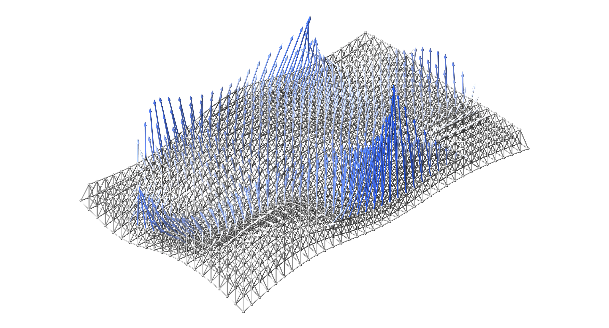

# AsapOptim.jl



High-performance, *general* structural optimization in the [Asap.jl](https://keithjlee.com/Asap.jl) environment.

AsapOptim maps a **design vector** to a differentiable structural analysis and back. The vector holds node positions, cross-section properties, connection stiffnesses and force densities. You write ordinary Julia objective and constraint functions. Gradients flow end-to-end through the solve by automatic differentiation, and any gradient-based optimizer (Nonconvex.jl, NLopt, Optim, your own loop) drives the design.

AsapOptim is a thin layer over Asap's differentiable core. It compiles design variables into sparse scatter maps and evaluates designs through Asap's pure, AD-transparent solve path. It re-implements no analysis and contains no hand-written adjoints. One unified core handles trusses, frames, semi-rigid joints, element loads and mixed models.

## Installation

```julia-repl
pkg> add AsapOptim
```

For the examples you will also want an AD engine and an optimizer:

```julia-repl
pkg> add Zygote Nonconvex NonconvexNLopt
```

## The workflow

Every optimization follows the same five steps:

1. **Model**: build and solve an `Asap.Model` as usual.
2. **Variables**: declare what the optimizer controls ([Design variables](guide/variables.md)).
3. **Parameters**: compile the model and variables into an [`OptParams`](@ref), once.
4. **Objective and constraints**: plain functions of [`solve_structure`](@ref)`(x, params)` results, or of [`GeometricProperties`](@ref)`(x, params)` when no solve is needed.
5. **Optimize**: hand the functions and `params.lb`/`params.ub` to your optimizer, then recover the final design with [`updatemodel`](@ref)`(params, x_optimal)`.

```julia
using Asap, AsapOptim
using Zygote                       # activates Asap's ChainRules extension

vars   = AbstractVariable[ ... ]   # step 2
params = OptParams(model, vars)    # step 3
x0     = copy(params.values)

objective(x) = compliance(solve_structure(x, params), params)   # step 4

value, gradient = Zygote.withgradient(objective, x0)            # step 5: any gradient-based optimizer from here
```

Start with the [Quick start](guide/quickstart.md).

## Package overview

```@docs
AsapOptim
```
